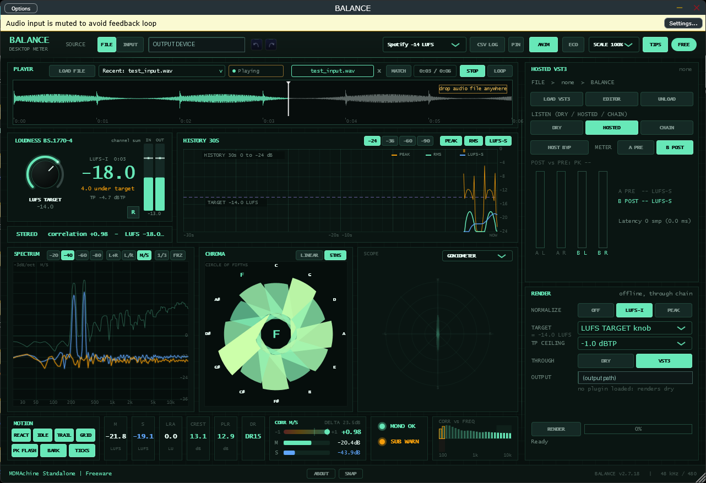
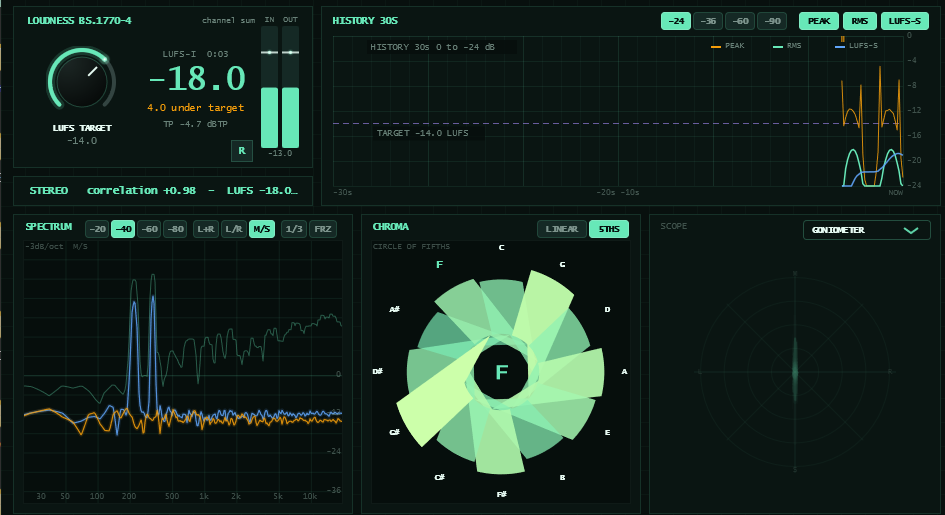

# MDMAchine BALANCE

**Free stereo and dynamics reference meter for mixing and mastering.** By A&E Concepts.

BALANCE measures loudness (BS.1770-4 LUFS), true peak, dynamic range, stereo correlation and spectral content in real time. It never modifies the audio passing through it: the host hears exactly what it sent in.

BALANCE is freeware. No licence file, no account, no time limit. The source is closed; this repository hosts the downloads, docs and issue tracker only.

## Download

Get the latest zip from the [Releases page](../../releases/latest).

| Platform | File | Formats |
|---|---|---|
| Windows 10/11 (64-bit) | `MDMAchine_BALANCE_2.7.19_win.zip` | VST3, CLAP, Standalone |
| macOS 11+ (Universal: Apple Silicon and Intel) | `MDMAchine_BALANCE_2.7.19_mac.zip` | AU, VST3, CLAP, Standalone |

Each zip includes the user manual (PDF and Markdown), an install guide, known issues, a bug report template and a SHA256SUMS file.

## Install

See [INSTALL.md](INSTALL.md).

## Known limits

- The Mac build is ad-hoc signed, not notarized. macOS may block it on first launch; see INSTALL.md.
- Windows binaries are not code-signed. SmartScreen may warn on first run.
- Intel Macs have been validated under Rosetta only, not on Intel hardware. Reports welcome.
- The link in the plugin footer does nothing yet.

The full list is in `known_issues.txt` inside each zip.

## Feedback and bugs

Open an [issue](../../issues). Include your OS, your DAW and its version, the plugin format, and the steps to reproduce. The bug report template in the zip lists what helps.

## Licence

Freeware, closed source. See [LICENSE](LICENSE).
